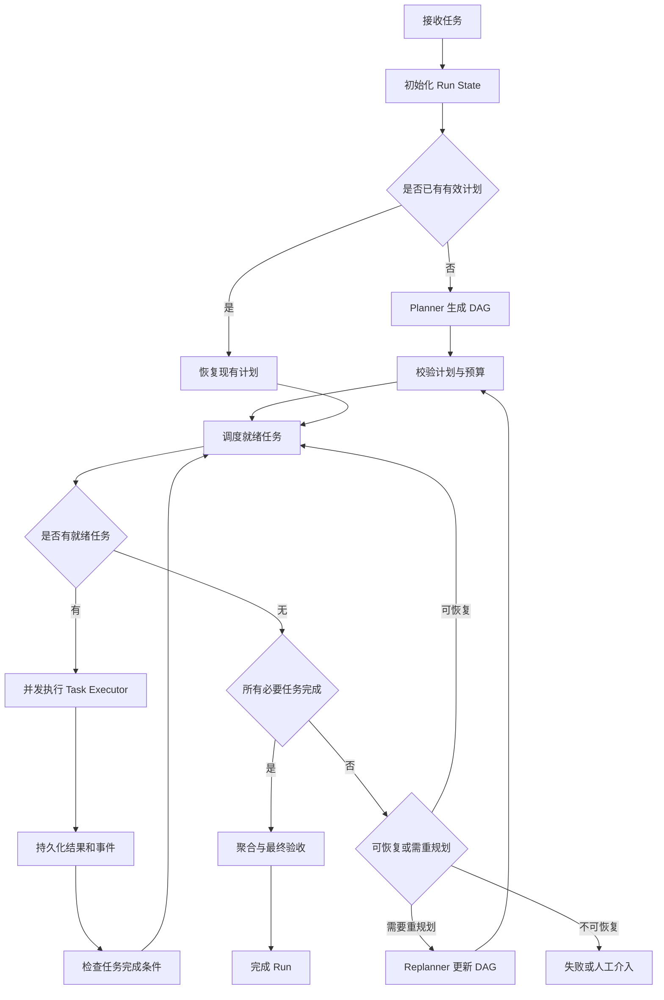
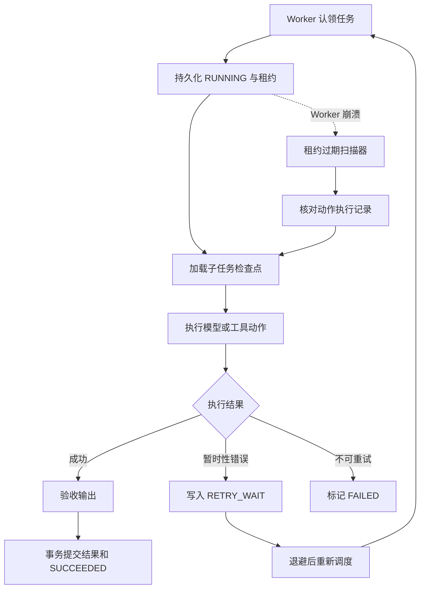

# Agent Card、A2A Task、MCP Tool 与 Agent Runtime：原理与架构设计

> 本文整理当前会话中的核心讨论，面向正在设计 Multi-Agent Runtime / Agent 管理平台的开发者。内容包含概念边界、运行时发现、注册中心、任务执行流程、状态管理、故障恢复与落地路线。
>
> **核心结论**
>
> - **Agent Card：发现与描述 Agent**——它是谁、具备哪些技能、从哪里调用。
> - **A2A Task：管理 Agent 协作中的一项工作**——任务是什么、执行到哪一步、产生了什么结果。
> - **MCP Tool：提供具体可调用能力**——搜索、数据库查询、文件读取、代码执行等。
> - **Agent Registry：管理 Agent 目录**——记录已注册 Agent 及其能力、入口、状态等信息。
> - **Agent Runtime：管理任务如何执行**——调度、执行循环、上下文、状态持久化、异常恢复与最终交付。

---

## 1. 总体概念与职责边界

### 1.1 三个核心概念

| 概念 | 核心问题 | 本质 | 示例 |
|---|---|---|---|
| Agent Card | 找谁？它能做什么？ | Agent 元数据与调用信息 | `research-agent` 的技能和 A2A Endpoint |
| A2A Task | 委托的工作是什么？进展如何？ | A2A 协议中的有状态任务对象 | 调研企业级 AI Agent 市场的任务 |
| MCP Tool | 具体调用什么能力？ | 由 MCP 暴露的工具接口 | `search_web(query)` |
| Agent Registry | 系统有哪些 Agent？ | Agent 元数据目录/注册中心 | PostgreSQL 中的 Agent 注册记录 |
| Agent Runtime | 如何可靠地执行任务？ | 运行、调度和治理机制 | Run、Task、Step、Executor、Recovery |

### 1.2 直观类比

- **Agent Card**：服务名片，说明身份、能力、入口。
- **A2A Task**：一张工作单，记录委托内容、状态与产出。
- **MCP Tool**：一项可执行的具体操作。
- **Registry**：服务目录，维护“有哪些服务可用”。
- **Runtime**：任务执行系统，负责把计划转化为可靠的执行过程。

### 1.3 A2A 与 MCP 的区别

```text
                 Agent
                   |
        +----------+----------+
        |                     |
       A2A                   MCP
        |                     |
        v                     v
     Other Agents         Tools / Resources
```

- **A2A** 面向 Agent 与 Agent 之间的互操作、任务委托和结果交付。
- **MCP** 面向模型/Agent 应用与工具、资源等能力之间的标准化连接。
- MCP Server 不一定是 Agent；一个 MCP Tool 通常只负责某项具体能力。
- A2A Agent 内部可以使用一个或多个 MCP Tool。

---

## 2. Agent Card

### 2.1 Agent Card 是什么

Agent Card 是一份描述 Agent 的元数据文档，帮助调用方了解：

- Agent 名称、描述与版本；
- 支持的技能（Skills）；
- A2A 服务入口；
- 能力声明，例如是否支持流式交互；
- 认证要求等与访问相关的信息（具体取决于协议版本与实现）。

简化示例：

```json
{
  \"name\": \"research-agent\",
  \"description\": \"负责市场研究与竞品分析\",
  \"url\": \"https://example.com/a2a\",
  \"version\": \"1.0.0\",
  \"capabilities\": {
    \"streaming\": true
  },
  \"skills\": [
    {
      \"id\": \"market_research\",
      \"name\": \"市场研究\",
      \"description\": \"研究指定行业、市场规模及竞争对手\"
    }
  ]
}
```

这是概念示例，并非特定 A2A SDK 版本的完整 schema。

### 2.2 Agent Card 负责与不负责的内容

| 负责 | 不负责 |
|---|---|
| 描述 Agent 身份、版本和技能 | 执行具体任务 |
| 提供或声明服务入口 | 保存每个任务的运行状态 |
| 提供调用方判断 Agent 是否适用的信息 | 保证 Agent 当前健康可用 |
| 声明适用的能力、认证等信息 | 替代实际授权和权限校验 |

**关键边界：Agent Card 是描述信息，不是任务，也不是 Agent 注册中心本身。**

### 2.3 如何获取 Agent Card

A2A 常见的 Agent Card 获取方式是通过 HTTP Well-Known URI，例如：

```text
https://agent.example.com/.well-known/agent-card.json
```

实际路径、公开 Card 与扩展 Card 的获取规则，应以采用的 A2A 协议版本及服务端配置为准。

必须区分：

1. **Card Retrieval（获取 Card）**：已知 URL，读取 Card。
2. **Agent Discovery（发现 Agent）**：知道系统里有哪些 Agent，以及它们的 Card 在哪里。

Well-Known URI 解决的是“已知某个 Agent 服务地址后，如何取得它的 Card”，并不会自动枚举运行环境里的所有 Agent。

---

## 3. A2A Task

### 3.1 A2A Task 是什么

A2A Task 用于表示一项需要被跟踪的工作。它关注：

- 任务 ID；
- 当前状态；
- 关联的消息；
- 任务产生的产物（Artifacts）；
- 继续查询、等待输入、取消或完成等生命周期操作（具体能力取决于协议版本和实现）。

例如，Supervisor 将任务委托给 Research Agent：

> 调研 2026 年企业级 AI Agent 市场，分析主要竞争对手，提供带来源链接的证据。

这项委托可以触发一个 A2A Task。

### 3.2 Message、Task 与 Artifact

- **Message**：一次通信内容，例如“请调研这个行业”。
- **Task**：被管理的一项工作，拥有状态和关联结果。
- **Artifact**：任务产出的内容，例如研究报告、证据集、结构化数据文件。

一项任务可能涉及多次消息，并产生一个或多个 Artifact。具体消息与任务的关系取决于 A2A 协议版本和交互模式。

概念性示例：

```json
{
  \"taskId\": \"task-001\",
  \"status\": \"working\",
  \"message\": \"调研企业级 AI Agent 市场\",
  \"artifacts\": []
}
```

以上是便于理解的伪 JSON，不是特定 SDK 的完整协议对象。

### 3.3 Task 生命周期

常见的任务状态语义包括：

- 执行中（Working）；
- 成功完成（Completed）；
- 失败（Failed）；
- 等待输入（Input Required）；
- 取消等终止或中间状态。

完整状态集合和转换规则应以具体 A2A 协议版本为准。

**关键边界：Task 管理工作状态与产出，不规定 Agent 内部如何推理或使用哪些工具。**

---

## 4. MCP Tool

### 4.1 MCP Tool 是什么

MCP Tool 是通过 Model Context Protocol（MCP）暴露给 Agent 应用调用的具体功能。常见示例：

| Tool | 输入示例 | 功能 |
|---|---|---|
| `search_web` | 查询关键词 | 搜索网页 |
| `fetch_page` | URL | 获取网页内容 |
| `query_market_db` | 受控查询参数 | 查询市场数据 |
| `extract_evidence` | 文档内容 | 抽取事实与来源 |

Tool 通常会声明名称、描述和输入参数 schema，由 MCP Server 提供实际实现，Agent 应用通过 MCP Client 与其交互。

简化示例：

```json
{
  \"name\": \"search_web\",
  \"description\": \"搜索公开网页\",
  \"inputSchema\": {
    \"type\": \"object\",
    \"properties\": {
      \"query\": {
        \"type\": \"string\"
      }
    },
    \"required\": [\"query\"]
  }
}
```

调用示意：

```json
{
  \"name\": \"search_web\",
  \"arguments\": {
    \"query\": \"2026 企业级 AI Agent 市场规模\"
  }
}
```

### 4.2 一次典型的 Tool 调用

1. Agent 应用向模型提供可用 Tool 的描述。
2. 模型或应用决定调用哪个 Tool。
3. MCP Client 将请求发送给 MCP Server。
4. Tool 执行搜索、数据库查询或其他操作。
5. 返回结果，Agent 将结果纳入上下文并继续推理。

MCP 定义工具的发现与调用方式，但不要求所有 Tool 都必须由 LLM 自主选择，也不意味着 MCP Server 本身一定是 Agent。

---

## 5. 三者如何协作：市场研究示例

假设平台需要生成一份市场调研报告：

```text
Supervisor Agent
    |
    | 读取 Agent Card / 查询 Registry
    v
Research Agent
    |
    | A2A Task：执行市场研究
    v
Research Agent 内部 Agent Loop
    |
    +-- MCP Tool: search_web
    +-- MCP Tool: fetch_page
    +-- MCP Tool: extract_evidence
    |
    v
A2A Task 完成，返回报告 Artifact
    |
    v
Supervisor 汇总多个 Agent 的结果
```

执行步骤：

1. Supervisor 通过 Registry 发现 Research Agent，并读取它的 Agent Card。
2. Supervisor 根据 Skill 判断该 Agent 是否适合当前工作。
3. Supervisor 通过 A2A 委托任务。
4. Research Agent 接收请求，执行内部推理循环。
5. Research Agent 调用一个或多个 MCP Tool。
6. Agent 整理证据与报告，更新任务状态并返回结果。
7. Supervisor 聚合各个任务的 Artifact，生成最终报告。

**Agent Card 负责发现；A2A Task 负责任务跟踪；MCP Tool 负责具体操作。**

---

## 6. `to_a2a()` 的含义

在 Google ADK 的语境中，`to_a2a()` 用于将 ADK Agent 包装/暴露为可通过 A2A 协议访问的应用。根据 ADK 的具体版本和示例，它可以协助构建 Agent Card，并配置相关的 A2A 请求处理组件。

概念性代码：

```python
from google.adk.a2a.utils.agent_to_a2a import to_a2a

# 已定义好的 ADK Agent
root_agent = ...

# 暴露为 A2A 应用
a2a_app = to_a2a(root_agent)
```

职责区分：

- `root_agent`：真正负责推理、规划和执行的 ADK Agent。
- `to_a2a(root_agent)`：A2A 适配和服务暴露入口。
- Agent Card：描述对外身份、技能和调用信息。
- A2A Task 相关组件：处理远程任务请求、状态与结果。

`to_a2a()` 不会自动把 Agent 内部的所有函数都变成 MCP Tool，也不会自动构建完整的多 Agent 调度平台。搜索、数据库、文件等内部工具仍需要单独配置，并进行权限控制。

---

## 7. Agent Card 的发现机制

### 7.1 为什么只提供 Card URL 不够

假设运行环境中有：

```text
Research Agent  -> :8001
Data Agent      -> :8002
Report Agent    -> :8003
```

每个 Agent 都可以暴露自己的 Card，但调用方必须先知道它的 URL，才能获取 Card。

所以，获取 Card 与发现 Agent 是两件事：

- **获取 Card**：给定 URL，获取能力描述。
- **发现 Agent**：找到有哪些 Agent、Card 在哪里，以及它们是否可用。

### 7.2 动态新增 Agent 的流程

```text
启动新 Agent
    |
    v
暴露 A2A Endpoint 和 Agent Card
    |
    v
向 Agent Registry 注册
    |
    v
Registry 获取并校验 Card
    |
    v
健康检查与权限校验
    |
    v
更新可用 Agent 目录
    |
    v
Supervisor 查询目录或按 Skill 搜索
    |
    v
选择 Agent，通过 A2A 委托任务
```

这是平台需要实现的动态注册与发现流程，不是 A2A 自动替所有运行环境执行的完整机制。

### 7.3 三种发现策略

| 策略 | 说明 | 适用场景 |
|---|---|---|
| 中心化 Registry | Agent 启动后注册到统一目录 | 动态 Agent 平台，推荐 |
| 固定目录/配置 | 从配置文件或固定目录加载 Agent | 小型开发环境 |
| 定时扫描或刷新 | 周期性读取目录或已知地址 | 低频变化的简单系统 |

ADK 可以支持特定的多 Agent 目录组织和 A2A 服务方式，但目录是否会在运行中热加载，必须核实具体 ADK 版本与服务实现，不能默认新增文件后就会自动发现。

---

## 8. PostgreSQL 作为 Agent Registry 的唯一事实来源

### 8.1 “唯一事实来源”不等于每次都直查数据库

如果 PostgreSQL 是 Registry 的 Source of Truth，含义是：

- Agent 的注册记录、技能、版本等最终以 PostgreSQL 为准；
- 缓存可以存在，但只是加速读取；
- 缓存与数据库不一致时，系统有办法重新以数据库数据校正；
- 主 Agent 不应该直接操作数据库，而是通过 Registry Service 查询目录。

推荐架构：

```text
Agent / Admin API
       |
       v
Agent Registry Service
       |
       +------> PostgreSQL（唯一事实来源）
       |
       +------> Registry Cache（可选 Redis / 本地缓存）
       |
       +------> 变更事件（可选）
       |
       v
Supervisor / Planner
```

### 8.2 建议的 Registry 字段

| 字段 | 用途 |
|---|---|
| `agent_id` | 稳定的 Agent 标识 |
| `name` | Agent 名称 |
| `card_url` | Agent Card 地址 |
| `endpoint` | A2A 服务入口 |
| `skills` | 技能列表或技能索引 |
| `status` | 注册、健康、下线等状态 |
| `version` | Agent 版本 |
| `last_heartbeat` | 最近心跳时间 |
| `tenant_id` | 租户/业务域隔离 |

实际实现时，可以根据查询模式将 Skills 规范化成独立表或采用 JSONB；要避免只为方便而把所有信息塞进一个不可查询的大 JSON。

### 8.3 Registry API 示例

```http
POST   /registry/agents
GET    /registry/agents
GET    /registry/agents?skill=market_research
DELETE /registry/agents/{agent_id}
```

这些是平台自定义的 Registry API，不是 A2A 协议强制规定的标准接口。

### 8.4 主 Agent 何时查询目录

| 场景 | 推荐行为 | 通常是否直查 PostgreSQL |
|---|---|---|
| 新用户请求开始规划 | 从 Registry 取相关 Agent，或按 Skill 检索 | 否，由 Registry 决定 |
| Agent Loop 每次迭代 | 复用当前任务选择结果 | 否 |
| 同一个长任务持续执行 | 复用 Agent 信息，必要时重新验证可用性 | 通常否 |
| 新 Agent 注册或注销 | 更新数据库，并使缓存失效/发布事件 | Registry 需要持久化变更 |
| 关键任务执行前 | 检查 Agent 健康状态、权限和 Endpoint | 视健康检查实现而定 |

**Agent 目录查询通常发生在规划和 Agent 选择阶段，而不是每次 LLM 调用或每次 Tool 调用时。**

### 8.5 缓存策略

#### 方案 A：TTL 缓存

例如目录缓存有效期为 30 秒：

- 首次读取时查询 Registry Service；
- TTL 内复用缓存；
- 过期后重新读取；
- 注册/注销时可以主动清理缓存。

优点：简单，适合 MVP。缺点：如果没有失效通知，发现新 Agent 可能有延迟。

#### 方案 B：事件驱动更新

Agent 注册、更新或注销成功后，Registry 发布 `AgentRegistryChanged` 事件。订阅者收到事件后刷新或失效本地缓存。

推荐组合：

> PostgreSQL 持久化 + 事件通知 + TTL 兜底 + 定时对账。

事件只是加速机制，数据库仍是事实来源。生产环境可采用 PostgreSQL Outbox 等方式降低“数据库事务成功、事件发布失败”造成的不一致风险。

### 8.6 健康状态与注册状态要分开

注册成功不等于 Agent 健康可用。建议至少区分：

- **Registered**：注册信息已登记；
- **Healthy / Available**：服务可访问并允许接收任务；
- **Unhealthy**：健康检查失败；
- **Draining**：不再接受新任务，但允许存量任务结束；
- **Offline / Deregistered**：已下线或注销。

具体状态枚举可以按平台定义。心跳、主动健康检查和任务失败反馈可以共同参与状态判定。

### 8.7 安全要求

动态注册机制不能允许任何未知 Agent 随意登记外部 URL 并获得内部调用权限。至少需要：

- 注册身份认证与授权；
- Endpoint 允许列表或网络边界校验；
- Card 内容与技能声明校验；
- 租户隔离；
- A2A 调用权限检查；
- 凭据安全存储；
- 防止 SSRF 等不可信 URL 风险。

Agent Card 中的技能声明不是授权凭证。真正调用时仍需校验调用方身份和权限。

---

## 9. Agent Runtime 是什么

### 9.1 定义

Agent Runtime 是让 Agent 能够持续执行任务的运行与治理机制。它不仅调用模型，还负责调度、上下文管理、工具执行、状态持久化、异常恢复、可观测性和结果交付。

可以把职责分成三层：

- **Registry**：有哪些 Agent 可用？
- **Supervisor / Planner**：当前目标如何拆解、应该调用谁？
- **Runtime**：如何执行任务、跟踪进度、处理异常并交付结果？

Supervisor 也可以作为 Runtime 内部的一个模块；把它单独列出是为了让职责更清晰。

### 9.2 推荐模块

| 模块 | 核心职责 |
|---|---|
| Run Manager | 管理一次完整用户请求的运行实例 |
| Planner | 生成子任务和依赖关系 |
| Scheduler | 判断哪些任务可以执行、分配资源 |
| Agent Executor | 调用本地 Agent 或远程 A2A Agent |
| Tool Executor | 调用 MCP Tool 或其他受控工具 |
| Context Manager | 组装上下文、管理历史与压缩 |
| State Store | 持久化 Run、Task、Step 和检查点 |
| Policy & Guardrails | 权限、参数、预算、审批、输出校验 |
| Recovery Manager | 超时、重试、恢复与补偿 |
| Trace & Observability | 记录模型/工具调用、耗时、成本和错误 |

这些是逻辑模块，不代表每个模块都必须单独部署成微服务。MVP 阶段可以全部放在一个 Python 服务中。

### 9.3 Runtime 执行全流程

```text
用户请求
   |
   v
1. 创建 Run
   |
   v
2. Planner 生成任务 DAG
   |
   v
3. Scheduler 选择可执行任务
   |
   v
4. Registry 解析合适的 Agent
   |
   v
5. Agent Executor 调用 Agent
   |
   v
6. Agent Loop：上下文 -> LLM -> Tool/子任务 -> 观察结果
   |
   v
7. 校验结果并持久化状态
   |
   +----> 失败：Recovery Manager 决定重试/降级/暂停
   |
   v
8. 任务依赖推进，必要时继续调度
   |
   v
9. 汇总 Artifact，完成 Run 并交付
```

---

## 10. Run、Task、Step 三层状态模型

为了支持长任务、恢复和审计，建议把一次完整运行拆成三层对象。

### 10.1 Run：一次完整运行

Run 是平台自己的运行对象，不是 A2A 标准对象。它代表用户发起的一次完整目标。

示例字段：

```json
{
  \"run_id\": \"run-1001\",
  \"status\": \"running\",
  \"goal\": \"生成企业级 AI Agent 市场研究报告\",
  \"max_steps\": 100,
  \"deadline\": \"2026-10-13T18:00:00+08:00\"
}
```

### 10.2 Task：一个可调度的工作单元

Task 表示计划中的一个子任务。它可能由本地 Agent 执行，也可能委托给远程 A2A Agent。平台 Task 与 A2A Task 可以有关联，但不必强行视为同一个对象。

示例：

```json
{
  \"task_id\": \"task-02\",
  \"goal\": \"分析主要竞争对手\",
  \"required_skill\": \"competitor_analysis\",
  \"depends_on\": [],
  \"expected_output\": \"含竞品能力和来源链接的结构化数据\",
  \"status\": \"pending\"
}
```

### 10.3 Step：具体执行步骤

Step 是某个 Task 中的具体操作，例如：

- LLM 请求；
- MCP Tool 调用；
- 远程 A2A 请求；
- 输出校验；
- 人工审批等待；
- 结果持久化。

建议的关系：

```text
Run
 ├── Task A
 │    ├── Step 1: LLM call
 │    ├── Step 2: MCP search_web
 │    └── Step 3: validate evidence
 ├── Task B
 │    ├── Step 1: A2A remote task
 │    └── Step 2: validate result
 └── Task C
      └── Step 1: generate report
```

### 10.4 推荐的数据表

| 表 | 用途 |
|---|---|
| `agent_runs` | 整体运行状态、目标、预算、截止时间 |
| `agent_tasks` | 子任务、依赖、负责人、重试次数、结果状态 |
| `agent_steps` | 执行步骤、输入输出引用、耗时、错误 |
| `agent_events` | 状态变化事件与审计记录 |
| `agent_artifacts` | 报告、证据集、文件等产物的元数据 |

大文件可以存放在对象存储，PostgreSQL 保存其引用、校验值和元数据。

---

## 11. Planner 与 Scheduler 的边界

### Planner 负责什么

Planner 负责将目标转换为可执行计划，例如：

```text
目标：生成市场研究报告

Task A：市场规模研究
Task B：竞品分析
Task C：技术趋势研究
Task D：证据核验（依赖 A、B、C）
Task E：生成最终报告（依赖 D）
```

Planner 还应为任务定义输入、输出、验收标准、技能要求和约束。

### Scheduler 负责什么

Scheduler 负责执行时机与资源分配：

- 哪些依赖已满足；
- 哪些任务可以并行；
- 选择哪个 Agent；
- 是否达到并发限制；
- 是否超过预算或截止时间；
- 是否需要排队、暂停或降级。

**Planner 决定计划；Scheduler 决定计划如何被执行。**

任务图可以是 DAG，但并不是所有 Agent 工作流都必须是 DAG。如果存在动态循环、反复澄清或探索式研究，可以采用带有运行时控制逻辑的图或状态机。

---

## 12. Agent Loop 与 Runtime 的边界

Agent Loop 是 Runtime 执行 Agent 时常见的一种内部循环，但 Runtime 不等于 Agent Loop。

典型 Agent Loop：

```text
构建上下文
    |
    v
调用 LLM
    |
    v
判断下一步
    |
    +--> 调用 Tool -> 观察结果 -> 更新上下文 -> 再次调用 LLM
    |
    +--> 请求补充信息 -> 暂停等待
    |
    +--> 输出完成结果
    |
    +--> 错误/超限 -> 进入恢复或终止
```

Runtime 还要处理 Agent Loop 之外的问题：

- 任务依赖和并行调度；
- 远程 A2A Task 跟踪；
- 全局预算和超时；
- 状态持久化与进程重启；
- 取消、重试、补偿；
- 审计与可观测性。

---

## 13. 失败处理与恢复策略

| 异常场景 | 建议处理 |
|---|---|
| 临时网络错误 | 有上限的指数退避重试 |
| Agent 服务不可用 | 重新健康检查，选择兼容候选或等待恢复 |
| LLM 限流 | 按限流信息退避，必要时降低并发 |
| Tool 参数错误 | 将错误反馈给 Agent 修正，限制修正次数 |
| 证据不足 | 补充检索或判定验收失败 |
| 等待人工审批 | 暂停任务，审批后恢复 |
| 超预算或截止时间 | 终止、降级或请求人工介入 |

必须注意：

1. 重试需要区分可重试错误与永久错误。
2. 有副作用的操作不能盲目重试。
3. 创建工单、发送通知、写业务数据库等操作需要幂等键、去重机制，必要时设计补偿流程。
4. 更换 Agent 不代表可以无缝迁移内部状态；需要验证技能、输入输出契约和上下文兼容性。

### 13.1 持久化不等于自动恢复

进程崩溃后，Runtime 需要：

1. 找到运行中或等待中的 Run；
2. 加载任务状态、最近检查点和执行记录；
3. 判断哪些任务已完成；
4. 识别执行结果不确定的外部操作；
5. 对可安全恢复的任务继续执行；
6. 对不确定的操作先核验，再决定重试；
7. 恢复调度并继续跟踪，直到终态。

因此，可靠恢复需要检查点、幂等性、状态机和恢复策略，而不是只把状态写入数据库。

---

## 14. 一个简化的 Runtime 伪代码

以下是帮助理解模块关系的伪代码，并非可直接运行的完整实现。

```python
async def run_agent_workflow(user_request):
    # 1. 创建运行实例
    run = await run_manager.create(user_request)

    # 2. 生成任务计划
    plan = await planner.build_plan(user_request)
    await state_store.save_plan(run.id, plan)

    while not run_manager.is_terminal(run.id):
        # 3. 找出依赖已满足的待执行任务
        tasks = await scheduler.get_ready_tasks(run.id)

        if not tasks:
            await recovery_manager.check_blocked_tasks(run.id)
            # 生产实现需重新判断终态、等待事件或超时，
            # 不能简单假设没有 ready task 就可以直接退出。
            break

        # 4. 按并发、预算和权限选择任务
        task = await scheduler.select_next(tasks)

        try:
            # 5. 根据技能从 Registry 选择 Agent
            agent = await registry.resolve(
                required_skill=task.required_skill
            )

            # 6. 执行本地 Agent 或远程 A2A Agent
            result = await executor.execute(
                agent=agent,
                task=task
            )

            # 7. 校验结果并持久化
            await validator.check(task, result)
            await state_store.mark_completed(task.id, result)

        except Exception as exc:
            # 8. 分类错误并决定重试、降级或暂停
            await recovery_manager.handle(task, exc)

    # 9. 汇总产物并完成交付
    return await run_manager.finalize(run.id)
```

生产实现还需要处理并发任务组、等待中的远程 Task、取消信号、租约、锁、事件持久化，以及不应在任务阻塞时错误结束 Run 的问题。

---

## 15. 可落地的技术路线

建议分阶段建设，避免一开始就开发过度复杂的分布式 Runtime。

### 第一阶段：同步执行 MVP

实现：

- Run / Task / Step 数据模型；
- Planner 与简单 Scheduler；
- 本地 Agent Executor；
- MCP Tool 调用；
- PostgreSQL 状态持久化；
- 基础日志和错误处理。

目标是让 2～3 个 Agent 完成一个可验证的端到端流程。

### 第二阶段：可靠执行

增加：

- 超时、重试、取消；
- 并发限制；
- 幂等处理；
- 检查点与恢复；
- 预算管理；
- Trace 与可观测性。

### 第三阶段：远程 Agent 协作

增加：

- A2A Client；
- Agent Card 获取；
- Agent Registry；
- A2A Task 状态跟踪；
- 远程结果归一化；
- Endpoint 健康检查。

### 第四阶段：动态 Agent 管理

增加：

- Agent Lifecycle Manager；
- 动态注册与注销；
- 事件驱动目录更新；
- 多租户权限；
- 动态扩缩容；
- 故障恢复与资源回收。

### 推荐的模块关系

```text
Agent Lifecycle Manager
        |
        +-- 创建 / 启动 / 停止 Agent
        |
        v
Agent Registry
        |
        +-- Agent Card / Skills / Endpoint
        +-- 注册状态 / 健康状态
        |
        v
Supervisor / Planner
        |
        v
Scheduler
        |
        v
Agent Executor
        |
        +-- Local Agent (ADK / LangGraph / custom)
        +-- Remote Agent (A2A)
        |
        v
Agent Loop
        |
        +-- LLM
        +-- MCP Tool
        +-- Context Manager
        |
        v
State Store / Recovery / Observability
```

---

## 16. 最终总结：设计时要守住的边界

1. **Agent Card ≠ Agent Registry**：Card 描述单个 Agent；Registry 管理整个 Agent 目录。
2. **获取 Card ≠ 发现 Agent**：知道 URL 才能获取 Card；要发现新 Agent，需要注册、目录、配置或其他发现机制。
3. **Agent Card ≠ A2A Task**：前者是元数据，后者是具体工作及其状态。
4. **A2A Task ≠ MCP Tool**：Task 管理任务生命周期；Tool 执行具体操作。
5. **A2A ≠ MCP**：A2A 面向 Agent-to-Agent；MCP 面向 Agent 应用与工具/资源连接。
6. **Registry 的唯一事实来源 ≠ 每次都查数据库**：可以通过 Registry Service、缓存和事件更新目录。
7. **Planner ≠ Scheduler**：Planner 生成计划；Scheduler 决定执行顺序、并发与资源分配。
8. **Agent Loop ≠ Agent Runtime**：Loop 负责 Agent 的迭代执行；Runtime 还负责任务调度、持久化、恢复、权限和交付。
9. **注册成功 ≠ 健康可用**：注册、健康检查、权限校验和任务执行能力需要分别管理。
10. **持久化 ≠ 自动恢复**：必须设计检查点、幂等、状态机与恢复策略。

> 最重要的架构原则：先明确 Run / Task / Step 的状态机和职责边界，再逐步加入 A2A、动态 Registry、事件通知和分布式执行能力。这样才能构建一个可维护、可恢复、可扩展的 Agent Runtime，而不只是把多个 Agent 连接起来。

---


# 附录：长程任务混合编排的 Agent Runtime 实现设计

> 适用场景：全局规划与局部探索混合任务；运行时间较长；子任务存在依赖且部分可并行；优先采用 Python、LangGraph 风格状态图，并支持替换模型、工具和远程 Agent。

## 1. 设计目标与核心结论

建议采用 **Plan-and-Execute + 局部 ReAct + DAG 并行调度 + 持久化状态机** 的混合架构。它不是简单地把多个 Agent 串起来，而是管理长任务的生命周期，支持任务拆解、并行执行、A2A 委派、检查点恢复、失败重试、证据追踪、动态重规划，以及模型和工具的独立替换。

核心原则：**LangGraph 管理执行流程，DAG 管理业务任务依赖，数据库管理可恢复状态。** 三者职责不同，不要把所有任务状态都塞进一个庞大的 Graph State。

## 2. 整体架构

```text
API / Task Gateway
  ├── 创建任务、查询进度、取消任务、人工审批
  ▼
Agent Runtime Core
  ├── Planner：目标分解、依赖建模、计划版本管理
  ├── DAG Scheduler：就绪任务、并发、优先级、租约
  ├── ReAct Executor：子任务内部推理和工具循环
  └── Evaluator / Replanner：质量验收、失败分析、重规划
  ▼
Execution Adapters
  ├── Agent Adapter：本地 Agent / A2A 远程 Agent
  ├── Tool Gateway：MCP / 业务 API / 数据库工具
  ├── Model Gateway：模型路由、超时、降级和用量统计
  └── Policy Engine：权限、预算、审批和安全约束
  ▼
Persistence
  ├── PostgreSQL：Run、Plan、Task、Dependency、Event、Tool Call
  ├── Checkpointer：图执行检查点
  └── Object Storage：大文本、文件、证据和最终产物
  ▼
Observability：结构化日志、Tracing、指标、告警、恢复扫描器
```

| 设计项 | 建议方案 | 原因 |
|---|---|---|
| 全局编排 | LangGraph 风格状态图 | 节点、条件边、循环和检查点边界清晰 |
| 局部执行 | ReAct Agent | 子任务可根据实际观察动态选择工具 |
| 任务依赖 | 显式 DAG | 支持并行、依赖阻塞和局部重跑 |
| 持久化 | PostgreSQL + Checkpointer | 状态可查询、任务可恢复 |
| 大型产物 | 对象存储 | 避免把长文本、文件和原始结果塞进状态表 |
| Agent 通信 | 统一适配器，支持 A2A | 将远程 Agent 视为一种执行后端 |
| 执行模式 | API + 后台 Worker | 请求响应与长时间执行解耦 |

第一版建议采用模块化单体：一个 API 服务、一个或多个 Worker、一个 PostgreSQL。待吞吐量、隔离要求或团队边界明确后再拆服务。

## 3. 模块边界

| 模块 | 职责 | 不应该承担的职责 |
|---|---|---|
| `runtime` | 生命周期、状态流转、停止条件 | 直接绑定特定模型厂商 |
| `planner` | 生成、校验、修订计划 | 直接执行任意工具 |
| `scheduler` | DAG 拓扑、就绪任务、并发和租约 | 决定任务语义是否正确 |
| `executor` | 执行子任务、管理 ReAct 循环 | 修改无关任务状态 |
| `agents` | 本地 Agent、A2A Agent 适配 | 绕过统一权限和审计 |
| `tools` | 工具注册、参数校验、实际调用 | 自主扩展授权范围 |
| `evaluation` | 完成条件、证据质量、结果验收 | 仅凭模型自评认定成功 |
| `persistence` | 任务、事件、租约、检查点和产物索引 | 承担模型推理 |
| `observability` | 日志、Trace、指标和告警 | 无限制保存敏感上下文 |

模块间优先通过 Python `Protocol` 或抽象基类交互。替换模型供应商时，只需要更换 `ModelProvider` 实现，不应修改 DAG Scheduler。

## 4. 状态模型

建议区分四类状态：

1. **Run State**：一次完整用户请求的全局状态，包括目标、全局状态、计划版本、取消标志、总预算、截止时间和最终摘要。
2. **Task State**：DAG 中单个子任务的状态，包括描述、输入输出、依赖、执行次数、租约、错误和验收结果。
3. **Execution State**：一次子任务执行的局部状态，包括 ReAct 轮次、必要上下文、当前观察、待处理调用、Token 预算和检查点。
4. **Evidence / Artifact State**：证据与产物的来源、引用、内容摘要、版本、存储 URI、校验状态和关联任务。

建议 Run 状态：`CREATED`、`RUNNING`、`WAITING_APPROVAL`、`PAUSED`、`SUCCEEDED`、`FAILED`、`CANCELLED`。

建议 Task 状态：`PENDING`、`READY`、`RUNNING`、`RETRY_WAIT`、`SUCCEEDED`、`FAILED`、`BLOCKED`、`SKIPPED`。

状态转换应经过统一校验入口。例如 `PENDING → READY` 要求强依赖满足；`READY → RUNNING` 要求 Worker 成功取得租约；`RUNNING → SUCCEEDED` 要求结果通过 Schema 和业务验收；`RUNNING → RETRY_WAIT` 仅用于符合重试策略的错误。若允许上游失败后继续执行，应显式定义 `allow_failure` 或降级结果策略，不能默认把失败视为成功。

### 4.1 Pydantic 领域对象骨架

```python
from enum import StrEnum
from typing import Any
from pydantic import BaseModel, Field

class RunStatus(StrEnum):
    CREATED = "created"
    RUNNING = "running"
    WAITING_APPROVAL = "waiting_approval"
    PAUSED = "paused"
    SUCCEEDED = "succeeded"
    FAILED = "failed"
    CANCELLED = "cancelled"

class TaskStatus(StrEnum):
    PENDING = "pending"
    READY = "ready"
    RUNNING = "running"
    RETRY_WAIT = "retry_wait"
    SUCCEEDED = "succeeded"
    FAILED = "failed"
    BLOCKED = "blocked"
    SKIPPED = "skipped"

class TaskSpec(BaseModel):
    id: str
    description: str
    depends_on: list[str] = Field(default_factory=list)
    execution_mode: str = "local_react"  # local_react / a2a / deterministic
    input: dict[str, Any] = Field(default_factory=dict)
    output_schema: dict[str, Any] = Field(default_factory=dict)
    max_attempts: int = 3
    timeout_seconds: int = 300
    required: bool = True

class TaskPlan(BaseModel):
    plan_version: int = 1
    goal: str
    tasks: list[TaskSpec]

class TaskRecord(BaseModel):
    task_id: str
    run_id: str
    status: TaskStatus = TaskStatus.PENDING
    attempt: int = 0
    result_ref: str | None = None
    error: dict[str, Any] | None = None
    lease_owner: str | None = None
    lease_expires_at: str | None = None
```

上述代码使用 Python 3.11+ 的 `StrEnum`；Python 3.10 可改为继承 `str, Enum`。计划版本应保留历史，已执行任务的输入和计划版本必须可追溯。

## 5. DAG 并行调度

例如研究报告任务：

```text
T1：确定候选平台
 ├── T2：收集架构资料 ──┐
 ├── T3：收集成本数据 ──┼──> T5：综合分析与证据核验 -> T6：生成报告
 └── T4：收集场景案例 ──┘
```

T2、T3、T4 相互独立，可以并行；T5 必须等待它们完成；T6 必须等待 T5 完成。

Scheduler 至少实现：依赖解析、就绪队列、并发控制、租约、重试退避、失败传播、公平调度和租约过期恢复。

```python
from graphlib import TopologicalSorter
from collections.abc import Iterable

def validate_dag(tasks: Iterable[dict]) -> None:
    tasks = list(tasks)
    task_ids = {t["id"] for t in tasks}
    if len(task_ids) != len(tasks):
        raise ValueError("Duplicate task IDs")

    dependencies = {}
    for task in tasks:
        deps = set(task.get("depends_on", []))
        if task["id"] in deps:
            raise ValueError("Self dependency")
        unknown = deps - task_ids
        if unknown:
            raise ValueError(f"Unknown dependencies: {unknown}")
        dependencies[task["id"]] = deps

    TopologicalSorter(dependencies).prepare()  # 检测环路

def get_ready_tasks(tasks: list[dict]) -> list[dict]:
    by_id = {t["id"]: t for t in tasks}
    ready = []
    for task in tasks:
        if task["status"] not in ("pending", "ready"):
            continue
        deps = [by_id[d] for d in task.get("depends_on", [])]
        if any(d["status"] in ("failed", "blocked") for d in deps):
            task["status"] = "blocked"
            continue
        if all(d["status"] == "succeeded" for d in deps):
            ready.append(task)
    return ready
```

这是内存算法示例。多 Worker 生产环境中，任务认领、状态转换和租约更新必须由数据库事务、条件更新或行锁保护，不能依赖各 Worker 的本地列表。

## 6. LangGraph 全局状态图

将编排拆为两个层次：

- **Global Graph**：控制规划、调度、等待、评估和重规划。
- **Task Executor**：执行一个 DAG 节点，可选确定性函数、局部 ReAct 或 A2A 远程 Agent。



### 6.1 Global Graph State

```python
import operator
from typing import Annotated, Any
from typing_extensions import TypedDict

class RuntimeState(TypedDict, total=False):
    run_id: str
    goal: str
    plan_version: int
    plan: dict[str, Any]
    ready_task_ids: list[str]
    completed_task_ids: list[str]
    replan_required: bool
    replan_reason: str | None
    final_result_ref: str | None
    error: dict[str, Any] | None
    events: Annotated[list[dict], operator.add]
```

`operator.add` 适用于追加式事件列表，不适用于多个并发节点直接覆盖同一个普通字典。计划、计数器和任务状态应使用单写者、明确 reducer 或数据库事务。

### 6.2 Graph 构建骨架

```python
from langgraph.graph import StateGraph, START, END

def build_runtime_graph(services):
    graph = StateGraph(RuntimeState)
    graph.add_node("initialize", services.initialize_run)
    graph.add_node("plan", services.create_or_load_plan)
    graph.add_node("dispatch", services.dispatch_ready_tasks)
    graph.add_node("evaluate", services.evaluate_progress)
    graph.add_node("replan", services.replan)
    graph.add_node("finalize", services.finalize_run)
    graph.add_node("fail", services.fail_run)

    graph.add_edge(START, "initialize")
    graph.add_edge("initialize", "plan")
    graph.add_edge("plan", "dispatch")
    graph.add_edge("dispatch", "evaluate")
    graph.add_conditional_edges(
        "evaluate",
        services.route_after_evaluation,
        {
            "continue": "dispatch",
            "replan": "replan",
            "finalize": "finalize",
            "fail": "fail",
        },
    )
    graph.add_edge("replan", "plan")
    graph.add_edge("finalize", END)
    graph.add_edge("fail", END)
    return graph.compile(checkpointer=services.checkpointer)
```

代码定义控制流，不绑定具体模型、ORM 或工具实现。`dispatch_ready_tasks` 可在节点内部使用受限并发池，也可使用 LangGraph Send API 动态扇出；动态扇出需要额外设计状态归并和失败传播。

对于长任务，推荐 **外层持久化调度循环 + 内层 LangGraph 子任务执行图**：外层管理 DAG、租约和任务状态；内层管理 ReAct、工具调用和局部验证。这也便于把子任务迁移到 A2A 远程 Agent。

## 7. 可替换的模型、工具和 Agent 接口

```python
from typing import Protocol, Any

class ModelProvider(Protocol):
    async def generate_structured(
        self, *, system_prompt: str,
        input_data: dict[str, Any],
        output_schema: dict[str, Any],
        model_profile: str,
    ) -> dict[str, Any]: ...

    async def generate(
        self, *, messages: list[dict[str, Any]],
        tools: list[dict[str, Any]],
        model_profile: str,
    ) -> dict[str, Any]: ...

class ToolExecutor(Protocol):
    async def execute(
        self, *, name: str, arguments: dict,
        context: dict, idempotency_key: str,
    ) -> dict: ...

class AgentInvoker(Protocol):
    async def invoke(
        self, *, agent_id: str, task: dict,
        context: dict, deadline_seconds: int,
    ) -> dict: ...
```

| 接口 | 第一版实现 | 后续替换方向 |
|---|---|---|
| `ModelProvider` | 统一封装的模型 API 客户端 | 其他厂商、私有部署模型 |
| `ToolExecutor` | 本地 Python 工具注册表 | MCP 工具网关、远程 API |
| `AgentInvoker` | 本地 Agent 执行器 | A2A 远程 Agent |
| `CheckpointStore` | LangGraph Checkpointer | 自定义持久化实现 |
| `ArtifactStore` | 本地开发存储或 MinIO | S3 兼容对象存储 |

工具调用统一经过 Tool Gateway：注册检查 → Schema 校验 → 用户/租户/任务权限检查 → 预算与超时检查 → 幂等执行 → 结果规范化 → 审计记录。Planner 和 Agent 不应直接访问数据库连接、任意 Shell 或任意网络地址。

## 8. 局部 ReAct Executor

局部执行器接收明确的子目标，在受限工具集和预算内运行，直到满足完成条件、等待人工审批或失败。输出应包含状态、产物引用、证据、使用量和错误，而不仅是自然语言。

```python
from dataclasses import dataclass, field
from typing import Any

@dataclass
class ExecutionContext:
    run_id: str
    task_id: str
    allowed_tools: set[str]
    max_steps: int = 12
    steps_used: int = 0
    observations: list[dict[str, Any]] = field(default_factory=list)

class ReActExecutor:
    def __init__(self, model, tool_gateway, policy, evaluator):
        self.model = model
        self.tool_gateway = tool_gateway
        self.policy = policy
        self.evaluator = evaluator

    async def execute(self, task: dict, context: ExecutionContext) -> dict:
        while context.steps_used < context.max_steps:
            decision = await self.model.next_action(
                task=task,
                observations=context.observations,
                allowed_tools=sorted(context.allowed_tools),
            )
            if decision["type"] == "finish":
                result = decision["result"]
                verdict = await self.evaluator.validate(
                    task=task, result=result
                )
                if not verdict["accepted"]:
                    return {
                        "status": "needs_replan",
                        "reason": verdict["reason"],
                    }
                return {"status": "succeeded", "result": result}

            if decision["type"] != "tool_call":
                raise ValueError("Unsupported action type")

            name = decision["tool"]
            if name not in context.allowed_tools:
                raise PermissionError("Tool not allowed")

            await self.policy.check(
                task=task, tool=name,
                arguments=decision["arguments"],
            )
            context.steps_used += 1
            observation = await self.tool_gateway.execute(
                name=name,
                arguments=decision["arguments"],
                context={"run_id": context.run_id,
                         "task_id": context.task_id},
                idempotency_key=f"{context.task_id}:{context.steps_used}",
            )
            context.observations.append(observation)

        return {"status": "failed",
                "error": {"code": "MAX_STEPS_EXCEEDED"}}
```

这是接口级骨架，`model.next_action()` 和 `evaluator.validate()` 需要具体实现。生产环境应将每次动作和观察持久化；幂等键必须是持久化的逻辑 action ID，同一个逻辑动作重试时复用同一 ID，而不是每次重启后重新生成。

### 8.1 长任务上下文管理

| 层次 | 内容 | 处理方式 |
|---|---|---|
| 当前执行上下文 | 当前目标、最近几轮动作与观察 | 进入当前模型输入 |
| 任务级摘要 | 已尝试方法、关键结论、未解决问题 | 定期压缩并校验 |
| 持久化证据 | 原始工具结果、来源、文件和完整审计记录 | 按需检索，不全部放入 Prompt |

任务摘要不能替代原始证据。最终结论应追溯到原始来源或经过验证的计算结果。

## 9. 异常恢复与可靠性

| 故障类型 | 处理方式 | 是否重规划 |
|---|---|---|
| 模型 API 超时或限流 | 有上限的指数退避，必要时切换模型 | 通常不需要 |
| 工具暂时不可用 | 按策略重试，保持同一逻辑动作 ID | 通常不需要 |
| 参数 Schema 错误 | 返回明确错误，让局部 Agent 修正 | 一般不需要 |
| 权限拒绝 | 停止操作并记录审计 | 不得通过重规划绕过权限 |
| 输出不符合要求 | 定向修正、重执行或补充证据 | 视影响范围决定 |
| 依赖任务永久失败 | 阻塞下游或选择允许的降级路径 | 通常需要评估 |
| Worker 崩溃 | 租约过期后重新认领，从检查点恢复 | 不一定需要 |
| 计划逻辑缺陷 | 保留已完成成果，修改受影响 DAG 节点 | 需要 |
| 预算耗尽或用户取消 | 停止新派发并安全收尾 | 不应自动扩大预算 |

### 9.1 必须处理的工程问题

- **至少一次执行与幂等性**：数据库事务无法与任意外部 API 调用构成全局原子事务，因此应容忍重复投递，并通过幂等键、调用记录和结果去重避免重复副作用。
- **租约与 fencing token**：Worker 使用事务、条件更新或行锁认领任务。过期租约可以恢复，但旧 Worker 可能仍在运行；应使用单调递增的 fencing token，防止过期 Worker 覆盖新执行者结果。
- **检查点与业务状态分离**：LangGraph Checkpointer 保存图执行状态，但不能替代业务任务表、工具调用审计或外部副作用的幂等控制。
- **取消与人工审批**：取消任务时停止新派发并向运行中任务发送取消信号。已发出的外部请求需区分“已取消”“无法确认结果”和“已经完成”。



如果 Worker 在外部 API 成功后、写入本地结果前崩溃，系统必须先核对动作是否生效，再决定是否重试。

## 10. PostgreSQL 数据模型

| 表名 | 核心字段 | 用途 |
|---|---|---|
| `agent_runs` | `run_id`、`status`、`goal`、`plan_version`、`budget` | 全局运行记录 |
| `agent_plans` | `run_id`、`version`、`plan_json`、`created_at` | 计划版本与历史 |
| `agent_tasks` | `task_id`、`run_id`、`status`、`attempt`、`lease`、`result_ref` | 子任务状态与认领 |
| `agent_task_dependencies` | `task_id`、`depends_on_task_id` | DAG 依赖关系 |
| `agent_events` | `event_id`、`run_id`、`task_id`、`event_type`、`payload` | 状态转换和审计事件 |
| `agent_tool_calls` | `action_id`、`task_id`、`tool_name`、`status`、`result_ref` | 工具调用与幂等恢复 |

约束与索引建议：

- `agent_tasks` 使用唯一 `task_id` 主键，或使用 `(run_id, task_id)` 唯一约束。
- `agent_task_dependencies` 对任务和依赖分别建立外键，并对二者组合建立唯一约束。
- `agent_tool_calls.action_id` 建立唯一约束，识别同一个逻辑动作。
- 为 `agent_tasks(status, lease_expires_at)`、`agent_tasks(run_id, status)` 建立索引。
- `agent_events` 采用追加式写入，不覆盖旧事件。
- `agent_plans` 的版本号对同一个 `run_id` 唯一，更新计划时采用乐观锁或事务校验版本。

同一个 PostgreSQL 实例可以承载业务表和 LangGraph 检查点表，但应分别管理表结构和生命周期。

## 11. 项目目录结构

```text
agent-runtime/
├── pyproject.toml
├── alembic.ini
├── migrations/
├── app/
│   ├── api/                    # FastAPI：创建、查询、取消任务
│   ├── domain/                 # Run / Task / Plan / 状态转换
│   ├── ports/                  # Model / Tool / Agent / Repository 接口
│   ├── adapters/
│   │   ├── models/             # 不同模型提供商
│   │   ├── tools/              # 本地工具、MCP、业务 API
│   │   ├── agents/             # 本地 Agent、A2A
│   │   └── storage/            # PostgreSQL、对象存储
│   ├── planner/                # planner、validator、replanner
│   ├── scheduler/              # DAG、dispatcher、leases、recovery
│   ├── executor/               # react、deterministic、task_runner
│   ├── runtime/                # state、graph、service、policies
│   ├── evaluation/             # task_evaluator、final_evaluator
│   └── observability/          # logging、tracing、metrics
├── workers/
│   ├── task_worker.py
│   └── recovery_worker.py
└── tests/
    ├── test_dag.py
    ├── test_transitions.py
    ├── test_react.py
    ├── test_recovery.py
    └── test_idempotency.py
```

## 12. API 与后台执行

长程任务不应在 HTTP 请求中同步运行到底。API 创建任务后立即返回 `run_id`，由 Worker 在后台执行。

| API | 作用 |
|---|---|
| `POST /runs` | 创建任务并提交后台执行 |
| `GET /runs/{run_id}` | 获取运行状态、整体进度和摘要 |
| `GET /runs/{run_id}/tasks` | 查询 DAG 任务和状态 |
| `GET /runs/{run_id}/events` | 获取执行事件和阶段变化 |
| `POST /runs/{run_id}/cancel` | 请求取消任务 |
| `POST /runs/{run_id}/resume` | 恢复暂停或满足恢复条件的任务 |
| `POST /runs/{run_id}/approve` | 提交人工审批结果 |
| `GET /runs/{run_id}/artifacts` | 查询报告、证据和其他产物 |

第一版可使用数据库任务表轮询；吞吐量增加后再引入消息队列。消息队列负责投递和唤醒 Worker，数据库仍是任务状态的权威来源。

## 13. 实施路线

### 阶段 1：最小可运行 Runtime
实现 Run / Task 模型、Planner、DAG 校验、单 Worker、局部 ReAct、工具注册表和基础状态查询。验收：完成多步骤任务并查看每个子任务执行记录。

### 阶段 2：并行与持久化恢复
增加 PostgreSQL 状态持久化、任务租约、并发上限、重试退避、检查点和恢复扫描器。验收：并行任务正确汇合；Worker 重启后能恢复未完成任务。

### 阶段 3：验收与重规划
增加结构化结果验证、证据契约、局部失败恢复、版本化计划和人工审批。验收：上游失败不会导致错误汇总；计划更新不会覆盖历史执行依据。

### 阶段 4：A2A 与多 Worker 扩展
增加 Agent Card 发现、远程任务委派、调用关联 ID、远程超时和结果回传。验收：本地 Agent 与远程 A2A Agent 通过统一任务契约被调度。

## 14. 最终建议

优先投入四项基础能力：

1. **结构化 DAG 与任务状态机**：解决任务拆解、并行和依赖问题。
2. **可恢复执行机制**：解决长任务中断、重复执行和失败重试。
3. **统一模型、工具和 Agent 接口**：支持技术替换与 A2A 集成。
4. **证据和产物治理**：确保最终输出可追溯、可验收，而不只是生成文本。

这四项能力稳定后，再扩展动态规划、多 Agent 协商、长期记忆和复杂调度策略，可以显著降低整体开发风险。

## 附录：与 A2A、MCP 和 Agent Runtime 的关系

- **Agent Card**：描述 Agent 身份、技能和调用入口。
- **A2A Task**：描述 Agent 间委派的工作及其状态和产物。
- **MCP Tool**：提供搜索、数据库查询、文件读取等具体操作。
- **Agent Registry**：维护可发现的 Agent 目录。
- **Agent Runtime**：负责规划、调度、执行循环、上下文、持久化、恢复、权限和最终交付。

在混合架构中，主 Agent / Orchestrator 使用 Plan-and-Execute 管理全局任务，通过 A2A 委派给专业 Agent；专业 Agent 内部可使用 ReAct、确定性工作流或其他执行策略。A2A 负责 Agent 间通信与任务委派，ReAct 和 Plan-and-Execute 负责执行策略，三者处于不同层次。
